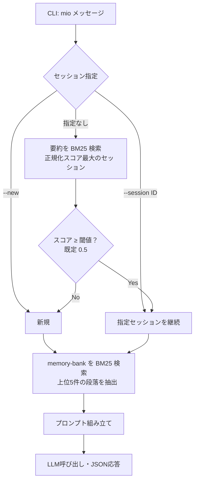
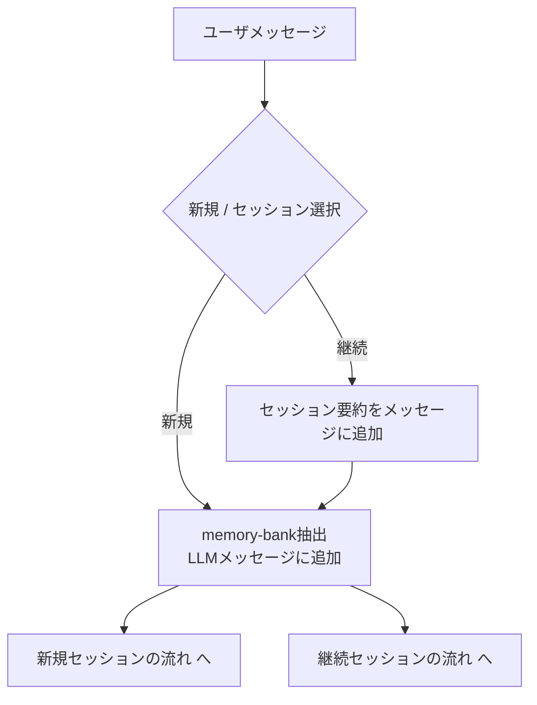
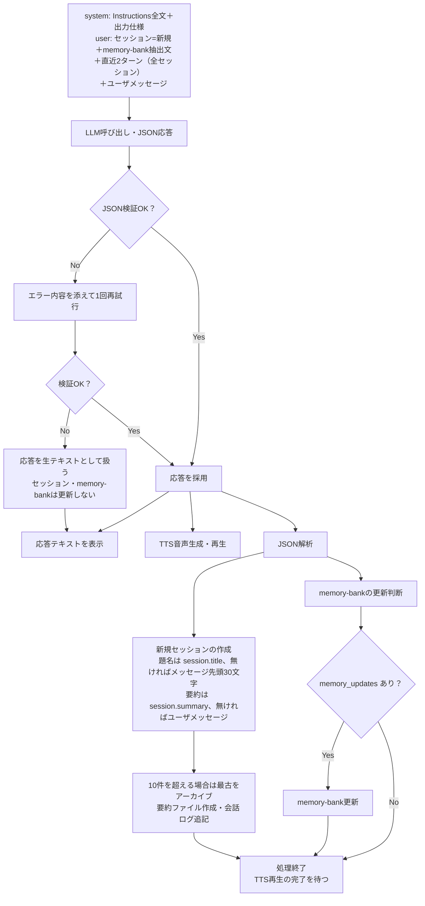
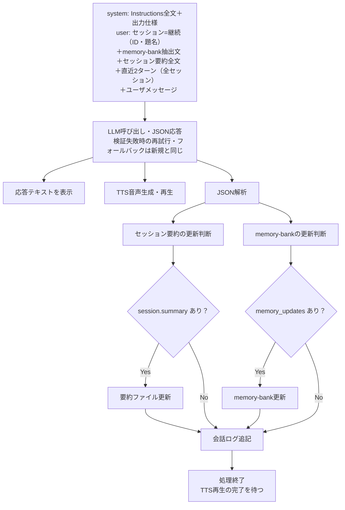
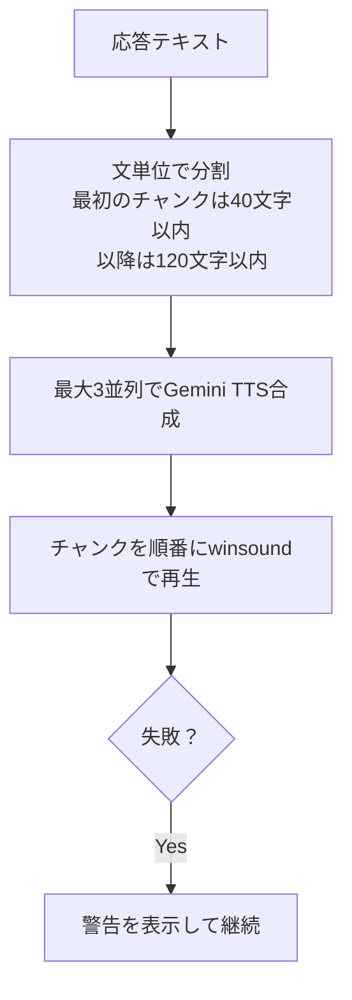

## Memo

* LLMはOpenRouter（`OPENROUTER_CHAT_MODEL`）。Web検索プラグイン（`plugins: [{"id": "web"}]`）を有効にしている
* 応答は JSON schema（strict）で受け取る
* memory-bankは単一md（`data/memory-bank.md`）に、個人情報・好み・その他セッションによらず記憶すべきことを記載
* セッションの保存先はローカルファイルフォルダ（`data/sessions/`）。最大10セッション。超えたら最古を `data/archive/` へ要約のみ退避
* セッション判定・memory抽出はどちらも BM25（日本語は文字 bigram）
* 直近会話は、セッションの新規・継続を問わず、全セッションのログから直近2ターンを渡す
* TTSは Gemini（`GEMINI_API_KEY`・`GEMINI_VOICE_ID`・`GEMINI_TTS_MODEL`）。`--no-tts` または未設定ならテキストのみ

## Flow

### 全体の流れ


### ユーザ入力を受けたときの最初 (セッションは自動判断)


### 新規セッションの流れ


### 継続セッションの流れ


### TTS（応答表示と並列）


### JSON応答の仕様
```json
{
  "reply": "表示・読み上げるテキスト",
  "session": {"title": "新規時のみ", "summary": "要約全文 / 更新不要なら null"},
  "memory_updates": [{"op": "add|replace|delete", "section": "見出し", "text": "内容"}]
}
```
